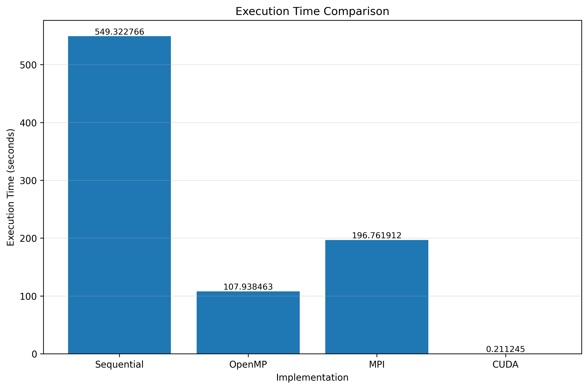
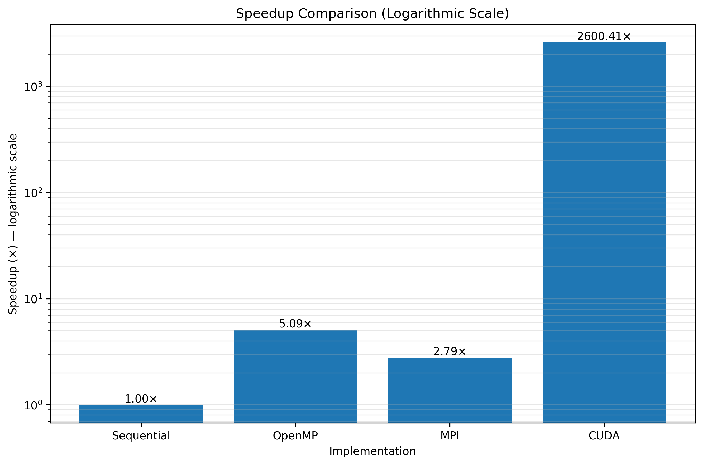

# Lab 1 — Matrix Multiplication using Sequential, OpenMP, MPI and CUDA

## Objective

Implement the same matrix multiplication problem using four computational approaches:

1. Sequential CPU
2. OpenMP shared-memory CPU
3. MPI distributed-memory CPU
4. CUDA GPU

The execution times of the different implementations are compared to understand the performance effects of sequential and parallel computation.

---

## Problem Statement

Multiply two `4000 × 4000` matrices:

```text
C = A × B
````

All elements of matrices `A` and `B` are initialized to `1.0`.

Therefore, every element of the resulting matrix `C` should be:

```text
4000.00
```

This provides a common verification value for all four implementations.

---

## Experiment Structure

```text
lab1/
│
├── README.md
│
├── sequential/
│   ├── README.md
│   └── matrix_sequential.c
│
├── openmp/
│   ├── README.md
│   └── matrix_openmp.c
│
├── mpi/
│   ├── README.md
│   └── matrix_mpi.c
│
├── cuda/
│   ├── README.md
│   └── matrix_cuda.cu
│
├── results/
│   ├── execution_time.png
│   └── speedup_log_scale.png
│
└── screenshots/
    ├── sequential/
    ├── openmp/
    ├── mpi/
    └── cuda/
```

---

# 1. Sequential CPU

The sequential implementation performs matrix multiplication using three nested loops on the CPU.

It acts as the **baseline** for calculating the speedup of the other implementations.

---

# 2. OpenMP

OpenMP uses shared-memory parallelism.

The matrix multiplication workload is divided among multiple CPU threads using an OpenMP parallel loop.

The experiment was executed using **8 OpenMP threads**.

---

# 3. MPI

MPI demonstrates distributed-memory parallelism.

Multiple MPI processes compute different portions of the matrix multiplication and communicate to distribute input data and collect the final result.

The experiment uses four Ubuntu machines/processes for the distributed setup.

---

# 4. CUDA

CUDA uses GPU parallelism.

A CUDA thread is assigned to each output element of matrix `C`, allowing a large number of matrix elements to be calculated concurrently.

---

## Verification

All four implementations solve the same mathematical problem.

Since both input matrices contain only `1.0` values, the expected result is:

```text
C[0][0] = 4000.00
```

The same verification value was obtained from all four implementations.

---

# Results

The following table presents the **actual execution times obtained during the experiment**.

Speedup is calculated relative to the Sequential implementation.

| Approach   | Execution Time (s) |  Speedup | Verification |
| ---------- | -----------------: | -------: | -----------: |
| Sequential |         549.322766 |    1.00× |      4000.00 |
| OpenMP     |         107.938463 |    5.09× |      4000.00 |
| MPI        |         196.761912 |    2.79× |      4000.00 |
| CUDA       |           0.211245 | 2600.41× |      4000.00 |

### Speedup Formula

```text
Speedup = Sequential Execution Time / Parallel Execution Time
```

---

# Performance Graphs

## 1. Execution Time Comparison

The following graph compares the execution time of the four implementations.



The graph shows that CUDA achieves the lowest execution time, while the Sequential implementation takes the longest time.

---

## 2. Speedup Comparison

The following graph shows the speedup of each implementation relative to the Sequential implementation.

A **logarithmic Y-axis** is used because the CUDA speedup is much larger than the CPU-based speedups.



The measured speedups are:

* Sequential: **1.00×**
* OpenMP: **5.09×**
* MPI: **2.79×**
* CUDA: **2600.41×**

The logarithmic scale allows all four implementations to be clearly visible in the same graph.

---

# Observations

The measured results show that:

* Sequential execution takes **549.322766 seconds** and provides the baseline performance.
* OpenMP reduces the execution time to **107.938463 seconds**, achieving a speedup of **5.09×**.
* MPI takes **196.761912 seconds**, achieving a speedup of **2.79×**.
* CUDA takes only **0.211245 seconds**, achieving a speedup of **2600.41×** over the sequential implementation.
* All four implementations produce the verification value `C[0][0] = 4000.00`.

The results demonstrate the performance differences between sequential CPU computation, shared-memory parallelism, distributed-memory parallelism, and GPU-based parallelism.

---

# Performance Comparison

### Sequential

The Sequential implementation serves as the baseline. Since the computation is performed using a single CPU execution flow, it has the highest execution time.

### OpenMP

OpenMP improves performance by dividing the matrix multiplication workload among multiple CPU threads. The measured speedup is **5.09×** compared with the Sequential implementation.

### MPI

MPI distributes the computation among multiple processes. Although it provides parallel execution, communication and data-distribution overhead affect the overall execution time. The measured speedup is **2.79×**.

### CUDA

CUDA provides the highest performance improvement by executing a large number of matrix operations in parallel on the GPU. The measured execution time is **0.211245 seconds**, resulting in a speedup of **2600.41×** compared with the Sequential implementation.

---

# Conclusion

The experiment successfully implements the same `4000 × 4000` matrix multiplication problem using four different computational approaches:

* Sequential CPU
* OpenMP shared-memory CPU
* MPI distributed-memory CPU
* CUDA GPU

The experimental results demonstrate the advantages and characteristics of different parallel computing models.

OpenMP improves performance through CPU thread-level parallelism, while MPI demonstrates distributed-memory computation with communication overhead. CUDA achieves the highest speedup by utilizing the massive parallel processing capability of the GPU.

The experiment provides practical understanding of sequential computation, shared-memory parallelism, distributed-memory parallelism, and GPU-based parallel computation.

---

# Result Files

The generated performance graphs are available in the `results/` directory:

* `results/execution_time.png` — Execution time comparison
* `results/speedup_log_scale.png` — Speedup comparison using logarithmic scale


