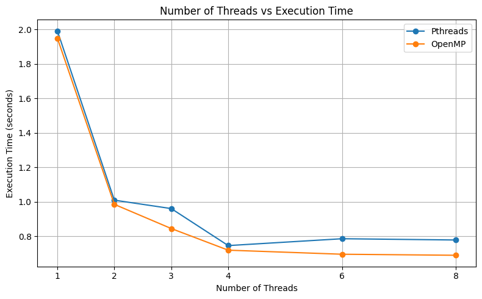
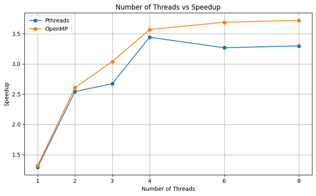
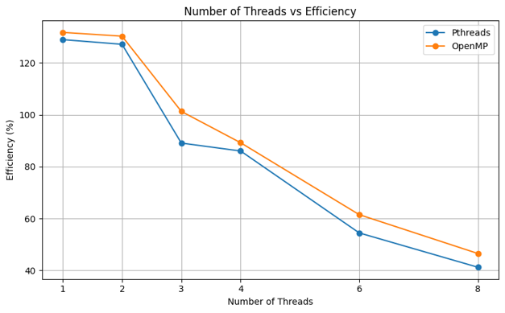

# Multithreaded Programming using Pthreads and OpenMP

## Experiment

Develop multithreaded programs using parallel programming libraries to understand thread creation, management, coordination, synchronization, and performance improvement.

---

## Aim

To develop multithreaded programs using **Pthreads** and **OpenMP** and understand:

- Thread creation and management
- Work distribution among threads
- Race conditions
- Synchronization
- Thread coordination
- Parallel performance
- Speedup and efficiency

---

## Technologies Used

- C
- GCC
- POSIX Threads (Pthreads)
- OpenMP
- Linux / Ubuntu
- Python
- Matplotlib
- VMware

---

## Repository Structure

```text
EXP-2.Develop Multithreaded Programs Using Parallel Programming Libraries
to Understand Thread Creation, Management, and Coordination/
│
├── README.md
│
├── pthread/
│   ├── readme.md
│   ├── thread1.c
│   ├── thread2.c
│   ├── thread_sum.c
│   ├── race.c
│   ├── mutex.c
│   ├── pthread_perf.c
│   └── screenshots/
│       ├── thread1_output.png
│       ├── thread2_output.png
│       ├── thread_sum_output.png
│       ├── thread_race_output.png
│       └── thread-mutex_output.png
│
├── openmp/
│   ├── readme.md
│   ├── omp1.c
│   ├── omp_sum.c
│   ├── omp_race.c
│   ├── omp_critical.c
│   ├── omp_barrier.c
│   ├── omp_perf.c
│   └── screenshots/
│       ├── omp1_output.png
│       ├── omp_sum_output.png
│       ├── omp_race_output.png
│       ├── omp_critical_output.png
│       └── omp_barrier_output.png
│
└── performance/
    ├── readme.md
    ├── sequential.c
    ├── plot_graph.py
    ├── threads_vs_execution_time.png
    ├── threads_vs_speedup.png
    └── threads_vs_efficiency.png
```

---

# Part A — Pthreads

Pthreads (POSIX Threads) provides a low-level interface for creating and managing threads in C.

The programs demonstrate:

1. Creating a single thread
2. Creating multiple threads
3. Dividing work among threads
4. Demonstrating a race condition
5. Solving the race condition using a mutex
6. Measuring multithreaded performance

### Compilation

For Pthreads programs:

```bash
gcc filename.c -o filename -pthread
```

### Execution

```bash
./filename
```

### Programs

| Program | Concept |
|---|---|
| `thread1.c` | Single thread creation |
| `thread2.c` | Multiple thread creation |
| `thread_sum.c` | Work distribution among threads |
| `race.c` | Race condition |
| `mutex.c` | Mutex synchronization |
| `pthread_perf.c` | Performance measurement |

Execution screenshots are available in:

```text
pthread/screenshots/
```

---

# Part B — OpenMP

OpenMP provides compiler directives for parallel programming in C.

The programs demonstrate:

1. Parallel regions
2. Thread identification
3. Work sharing
4. Reduction
5. Race conditions
6. Critical-section synchronization
7. Barrier-based thread coordination
8. Performance measurement

### Compilation

For OpenMP programs:

```bash
gcc filename.c -o filename -fopenmp
```

### Execution

```bash
./filename
```

### Programs

| Program | Concept |
|---|---|
| `omp1.c` | Parallel region and thread identification |
| `omp_sum.c` | Work sharing and reduction |
| `omp_race.c` | Race condition |
| `omp_critical.c` | Critical-section synchronization |
| `omp_barrier.c` | Thread coordination using barrier |
| `omp_perf.c` | Performance measurement |

Execution screenshots are available in:

```text
openmp/screenshots/
```

---

# Part C — Performance Analysis

The performance analysis compares **sequential, Pthreads, and OpenMP** implementations using execution time, speedup, and efficiency.

## Thread Counts Tested

```text
1, 2, 3, 4, 6, 8
```

The experiment was performed in an **Ubuntu virtual machine using VMware**.

---

## Sequential Baseline

The sequential program was executed 10 times.

The average sequential execution time obtained was:

```text
2.568768 seconds
```

This value was used as the sequential baseline for calculating speedup and efficiency.

---

## Performance Metrics

### Speedup

Speedup shows how much faster the parallel program executes compared with the sequential program.

```text
Speedup = Sequential Time / Parallel Time
```

### Efficiency

Efficiency shows how effectively the available threads are being utilized.

```text
Efficiency = Speedup / Number of Threads × 100
```

---

# Performance Graphs

## 1. Number of Threads vs Execution Time

This graph compares the execution time of Pthreads and OpenMP for different numbers of threads.



---

## 2. Number of Threads vs Speedup

This graph shows the speedup obtained using Pthreads and OpenMP compared with the sequential baseline.



---

## 3. Number of Threads vs Efficiency

This graph shows the efficiency obtained for different numbers of threads.



---

# Observations

- Increasing the number of threads generally reduced execution time.
- Both Pthreads and OpenMP achieved speedup compared with the sequential baseline.
- Speedup did not increase linearly with the number of threads.
- Increasing the number of threads does not always produce proportional performance improvement.
- Thread creation, scheduling, memory access, synchronization, and virtualization overhead can affect performance.
- Execution times may vary between runs because the experiment was performed inside a virtual machine.
- Pthreads provides explicit control over thread creation and synchronization.
- OpenMP provides a simpler higher-level approach to parallel programming.

---

# Conclusion

The experiment demonstrates that multithreading can improve execution time by distributing computational work among multiple threads.

Pthreads provides explicit control over thread creation and synchronization, while OpenMP provides a simpler higher-level approach to parallel programming.

The experiment also demonstrates that increasing the number of threads does not always result in proportional performance improvement because of parallelization and system overhead.

---

# Learning Outcomes

After completing this experiment, the following concepts were understood:

- Creation and management of threads
- Work distribution
- Shared data and race conditions
- Mutex-based synchronization
- OpenMP parallel regions
- Reduction and work sharing
- Critical sections
- Barriers and thread coordination
- Performance measurement
- Speedup and efficiency analysis

---

## Tools Used

- C
- GCC
- Pthreads
- OpenMP
- Python
- Matplotlib
- Ubuntu Linux
- VMware
