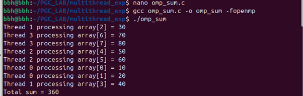
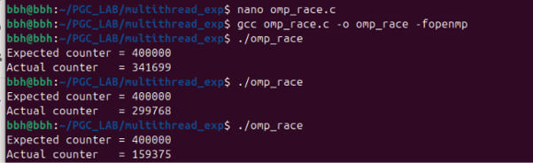
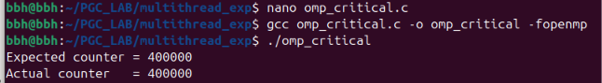
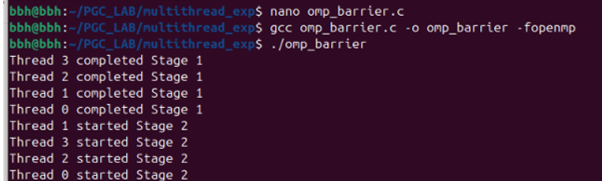
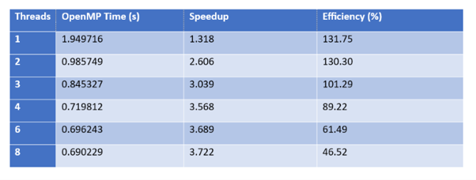

# Part B — OpenMP

## Objective

To understand parallel programming using OpenMP and learn about parallel regions, work sharing, race conditions, synchronization, thread coordination, and performance.

---

## Programs

| Program | Concept Demonstrated |
|---|---|
| `omp1.c` | Parallel region and thread identification |
| `omp_sum.c` | Work sharing and reduction |
| `omp_race.c` | Race condition |
| `omp_critical.c` | Synchronization using critical section |
| `omp_barrier.c` | Thread coordination using barrier |
| `omp_perf.c` | Performance analysis |

---

## 1. `omp1.c` — Parallel Region

### Purpose

Demonstrates how OpenMP creates multiple threads inside a parallel region.

### Important Functions

```c
omp_get_thread_num()
omp_get_num_threads()
```

### Compile

```bash
gcc omp1.c -o omp1 -fopenmp
```

### Run

```bash
./omp1
```

### Concept

The following directive creates a parallel region:

```c
#pragma omp parallel
```

Each thread executes the code inside the parallel region.

`omp_get_thread_num()` returns the ID of the current thread.

`omp_get_num_threads()` returns the total number of threads in the parallel region.

The exact number of threads depends on the OpenMP runtime and system configuration.

### Output Screenshot


---

## 2. `omp_sum.c` — Work Sharing and Reduction

### Purpose

Demonstrates how OpenMP divides loop iterations among threads and safely combines partial results using reduction.

### Compile

```bash
gcc omp_sum.c -o omp_sum -fopenmp
```

### Run

```bash
./omp_sum
```

### Important Directive

```c
#pragma omp parallel for reduction(+:total_sum)
```

### Concept

The `parallel for` directive divides loop iterations among multiple threads.

The `reduction` clause allows each thread to maintain its own partial result and safely combine the results at the end.

For example:

```text
10 + 20 + 30 + 40 + 50 + 60 + 70 + 80 = 360
```

### Output Screenshot



---

## 3. `omp_race.c` — Race Condition

### Purpose

Demonstrates a race condition when multiple threads access and modify shared data.

### Compile

```bash
gcc omp_race.c -o omp_race -fopenmp
```

### Run

```bash
./omp_race
```

### Concept

Multiple threads increment the same shared counter.

When multiple threads modify the same variable without synchronization, the operations can interfere with each other.

As a result, the final value may be different from the expected value.

This demonstrates the need for synchronization when accessing shared data.

### Output Screenshot



---

## 4. `omp_critical.c` — Critical Section

### Purpose

Demonstrates how OpenMP protects a critical section using the `critical` directive.

### Compile

```bash
gcc omp_critical.c -o omp_critical -fopenmp
```

### Run

```bash
./omp_critical
```

### Important Directive

```c
#pragma omp critical
```

### Concept

Only one thread at a time can execute the code inside the critical section.

This prevents multiple threads from modifying shared data simultaneously.

### Output Screenshot



---

## 5. `omp_barrier.c` — Thread Coordination

### Purpose

Demonstrates synchronization between threads using an OpenMP barrier.

### Compile

```bash
gcc omp_barrier.c -o omp_barrier -fopenmp
```

### Run

```bash
./omp_barrier
```

### Important Directive

```c
#pragma omp barrier
```

### Concept

A barrier makes threads wait until all threads reach the barrier.

No thread can continue beyond the barrier until all threads have reached that point.

This demonstrates thread coordination during parallel execution.

### Output Screenshot



---

## 6. `omp_perf.c` — Performance Analysis

### Purpose

To measure the execution time of an OpenMP program using different numbers of threads and calculate speedup and efficiency.

### Compile

```bash
gcc omp_perf.c -o omp_perf -fopenmp
```

### Run

```bash
./omp_perf
```

### Threads Tested

```text
1, 2, 3, 4, 6, 8
```

### Performance Results

The following results were obtained for different numbers of OpenMP threads.

| Threads | OpenMP Time (s) | Speedup | Efficiency (%) |
|---:|---:|---:|---:|
| 1 | 1.949716 | 1.318 | 131.75 |
| 2 | 0.985749 | 2.606 | 130.30 |
| 3 | 0.845327 | 3.039 | 101.29 |
| 4 | 0.719812 | 3.568 | 89.22 |
| 6 | 0.696243 | 3.689 | 61.49 |
| 8 | 0.690229 | 3.722 | 46.52 |

### Performance Metrics

#### Speedup

```text
Speedup = Sequential Time / OpenMP Time
```

#### Efficiency

```text
Efficiency = Speedup / Number of Threads × 100
```

### Performance Result Screenshot



The performance results are used in **Part C — Performance Analysis** to compare OpenMP with the sequential and Pthreads implementations.

> **Note:** Efficiency values above 100% for lower thread counts are due to run-to-run timing variation and the measured sequential baseline. They do not represent actual CPU utilization above 100%.

---

# Important OpenMP Concepts

## Parallel Region

```c
#pragma omp parallel
```

Creates a team of threads to execute a block of code.

## Parallel For

```c
#pragma omp parallel for
```

Divides loop iterations among multiple threads.

## Reduction

```c
reduction(+:sum)
```

Allows each thread to maintain a partial result and safely combine the results at the end.

## Critical Section

```c
#pragma omp critical
```

Allows only one thread at a time to execute a specific section of code.

## Barrier

```c
#pragma omp barrier
```

Makes threads wait until all threads reach the same point.

---

# Pthreads vs OpenMP

| Feature | Pthreads | OpenMP |
|---|---|---|
| Programming level | Lower-level | Higher-level |
| Thread creation | Explicit | Mostly handled by OpenMP |
| Work distribution | Programmer controlled | OpenMP can distribute work |
| Synchronization | Mutex, join, etc. | Critical, barrier, reduction, etc. |
| Code complexity | More code | Less code |
| Control | More explicit | More convenient |

---

## Key Learning

Through these programs, the following OpenMP concepts were understood:

- Parallel regions
- Thread identification
- Work sharing
- Reduction
- Race conditions
- Critical sections
- Barriers
- Thread coordination
- Parallel performance
- Speedup
- Efficiency

---

## Screenshots

Execution screenshots for the OpenMP programs are available in:

```text
screenshots/
```

The screenshots provide execution evidence for parallel regions, work sharing, race conditions, synchronization, thread coordination, and performance analysis.