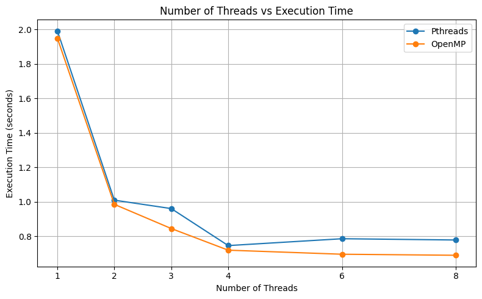
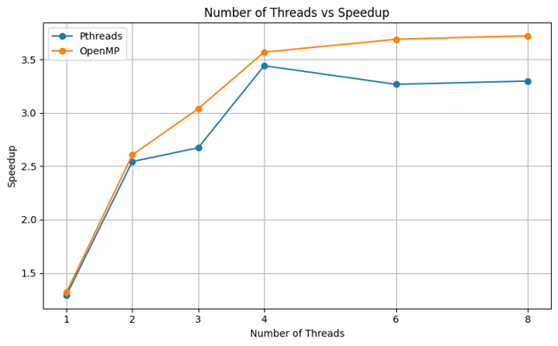
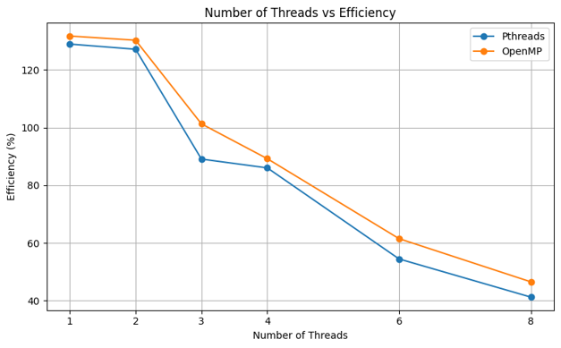

````markdown
# Part C — Performance Analysis

## Objective

To compare sequential, Pthreads, and OpenMP implementations using execution time, speedup, and efficiency.

---

## Performance Experiment

The performance of the programs was measured using different numbers of threads.

### Thread Counts Tested

```text
1, 2, 3, 4, 6, 8
````

The experiment was performed in an Ubuntu virtual machine using VMware.

---

## Sequential Baseline

The sequential program was executed 10 times.

The average sequential execution time obtained was:

```text
2.568768 seconds
```

This value was used as the sequential baseline for calculating speedup and efficiency.

---

## Performance Metrics

### Speedup

Speedup shows how much faster the parallel program executes compared with the sequential program.

```text
Speedup = Sequential Time / Parallel Time
```

### Efficiency

Efficiency shows how effectively the available threads are being utilized.

```text
Efficiency = Speedup / Number of Threads × 100
```

---

# Performance Graphs

## 1. Number of Threads vs Execution Time

This graph compares the execution time of Pthreads and OpenMP for different numbers of threads.



---

## 2. Number of Threads vs Speedup

This graph shows the speedup obtained using Pthreads and OpenMP compared with the sequential baseline.



---

## 3. Number of Threads vs Efficiency

This graph shows the efficiency obtained for different numbers of threads.



---

# Observations

* Increasing the number of threads generally reduced execution time.
* Both Pthreads and OpenMP achieved speedup compared with sequential execution.
* Speedup did not increase linearly with the number of threads.
* Increasing the number of threads does not always produce proportional performance improvement.
* Thread creation, scheduling, memory access, synchronization, and virtualization overhead can affect performance.
* Execution times may vary between runs because the experiment was performed inside a virtual machine.
* Efficiency values above 100% at lower thread counts are due to measurement variation between the sequential baseline and individual parallel runs.

---

# Conclusion

The experiment demonstrates that multithreading can improve execution time by distributing computational work among multiple threads.

Pthreads provides explicit control over thread creation and synchronization, while OpenMP provides a simpler higher-level approach to parallel programming.

The experiment also shows that increasing the number of threads does not always result in proportional performance improvement because of parallelization and system overhead.

---

## Tools Used

* C
* GCC
* Pthreads
* OpenMP
* Python
* Matplotlib
* Ubuntu Linux
* VMware

````
