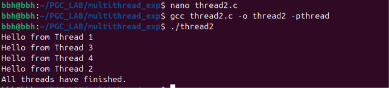
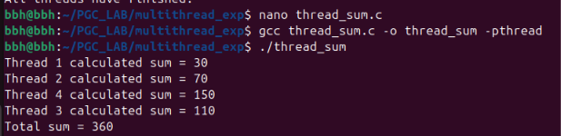
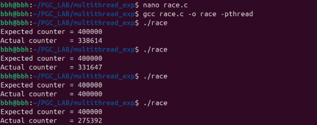
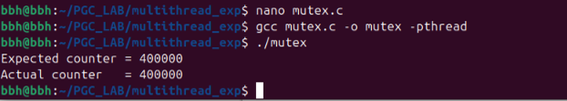
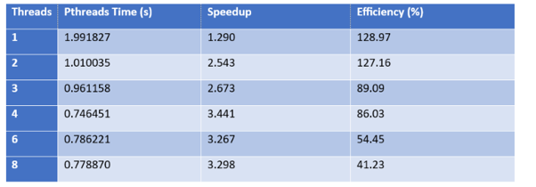

# Part A — Pthreads

## Objective

To understand thread creation, management, work distribution, race conditions, synchronization, and performance using POSIX Threads (Pthreads).

---

## Programs

| Program | Concept Demonstrated |
|---|---|
| `thread1.c` | Creating and joining a single thread |
| `thread2.c` | Creating and managing multiple threads |
| `thread_sum.c` | Dividing work among threads |
| `race.c` | Demonstrating a race condition |
| `mutex.c` | Preventing race conditions using a mutex |
| `pthread_perf.c` | Measuring parallel execution performance |

---

## 1. `thread1.c` — Single Thread Creation

### Purpose

Demonstrates how to create one additional thread using Pthreads.

### Important Functions

```c
pthread_create()
pthread_join()
```

### Compile

```bash
gcc thread1.c -o thread1 -pthread
```

### Run

```bash
./thread1
```

### Concept

The main thread creates a new thread using `pthread_create()`.

The main thread waits for the new thread to finish using `pthread_join()`.

### Output Screenshot


---

## 2. `thread2.c` — Multiple Threads

### Purpose

Demonstrates the creation and management of multiple threads.

### Compile

```bash
gcc thread2.c -o thread2 -pthread
```

### Run

```bash
./thread2
```

### Concept

Multiple threads are created using an array of `pthread_t`.

The output order may vary because the operating system schedules the threads independently.

### Output Screenshot



---

## 3. `thread_sum.c` — Work Distribution

### Purpose

Demonstrates how a computational task can be divided among multiple threads.

### Compile

```bash
gcc thread_sum.c -o thread_sum -pthread
```

### Run

```bash
./thread_sum
```

### Concept

The input array is divided into smaller portions.

Each thread calculates the sum of its assigned portion. The partial results are then combined to obtain the final sum.

This demonstrates basic parallel work distribution.

### Output Screenshot



---

## 4. `race.c` — Race Condition

### Purpose

To demonstrate a race condition when multiple threads access and modify shared data.

### Compile

```bash
gcc race.c -o race -pthread
```

### Run

```bash
./race
```

### Concept

Multiple threads increment the same shared variable.

Since the increment operation is not protected, threads may interfere with each other.

Therefore, the final result may be different from the expected value.

This demonstrates why synchronization is required when multiple threads access shared data.

### Output Screenshot



---

## 5. `mutex.c` — Synchronization Using Mutex

### Purpose

To solve the race condition using a mutex.

### Compile

```bash
gcc mutex.c -o mutex -pthread
```

### Run

```bash
./mutex
```

### Concept

A mutex allows only one thread at a time to enter the critical section.

### Important Functions

```c
pthread_mutex_init()
pthread_mutex_lock()
pthread_mutex_unlock()
pthread_mutex_destroy()
```

The shared counter is protected using the mutex so that the expected result is obtained.

### Output Screenshot



---

## 6. `pthread_perf.c` — Performance Analysis

### Purpose

To measure the execution time of a parallel program using different numbers of threads and calculate speedup and efficiency.

### Compile

```bash
gcc pthread_perf.c -o pthread_perf -pthread
```

### Run

```bash
./pthread_perf
```

### Threads Tested

```text
1, 2, 3, 4, 6, 8
```

### Performance Results

The following results were obtained for different numbers of Pthreads.

| Threads | Pthreads Time (s) | Speedup | Efficiency (%) |
|---:|---:|---:|---:|
| 1 | 1.991827 | 1.290 | 128.97 |
| 2 | 1.010035 | 2.543 | 127.16 |
| 3 | 0.961158 | 2.673 | 89.09 |
| 4 | 0.746451 | 3.441 | 86.03 |
| 6 | 0.786221 | 3.267 | 54.45 |
| 8 | 0.778870 | 3.298 | 41.23 |

### Performance Metrics

#### Speedup

```text
Speedup = Sequential Time / Pthreads Time
```

#### Efficiency

```text
Efficiency = Speedup / Number of Threads × 100
```

### Performance Result Screenshot



The performance results are used in **Part C — Performance Analysis** to compare Pthreads with the sequential and OpenMP implementations.

> **Note:** Efficiency values above 100% for 1 and 2 threads are due to run-to-run timing variation and the measured sequential baseline. They do not represent actual CPU utilization above 100%.

---

## Key Learning

Through these programs, the following Pthreads concepts were understood:

- Thread creation
- Thread joining
- Multiple thread management
- Work distribution
- Shared data
- Race conditions
- Critical sections
- Mutex synchronization
- Parallel performance
- Speedup and efficiency

---

## Screenshots

Execution screenshots for the Pthreads programs are available in:

```text
screenshots/
```

The screenshots provide execution evidence for thread creation, work distribution, race conditions, mutex synchronization, and performance analysis.