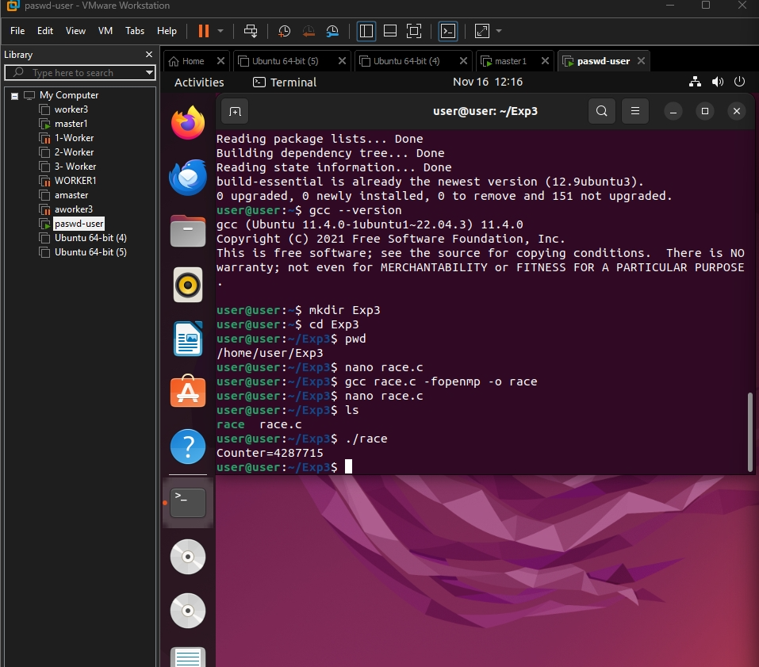
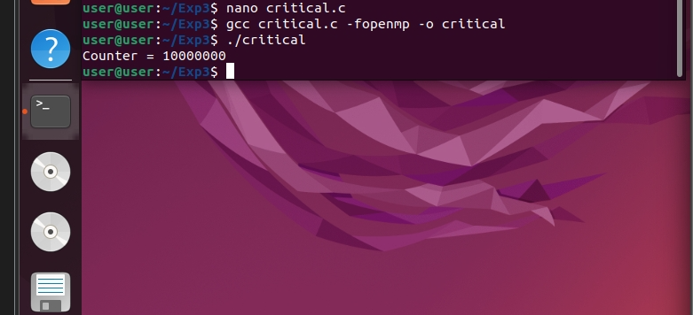
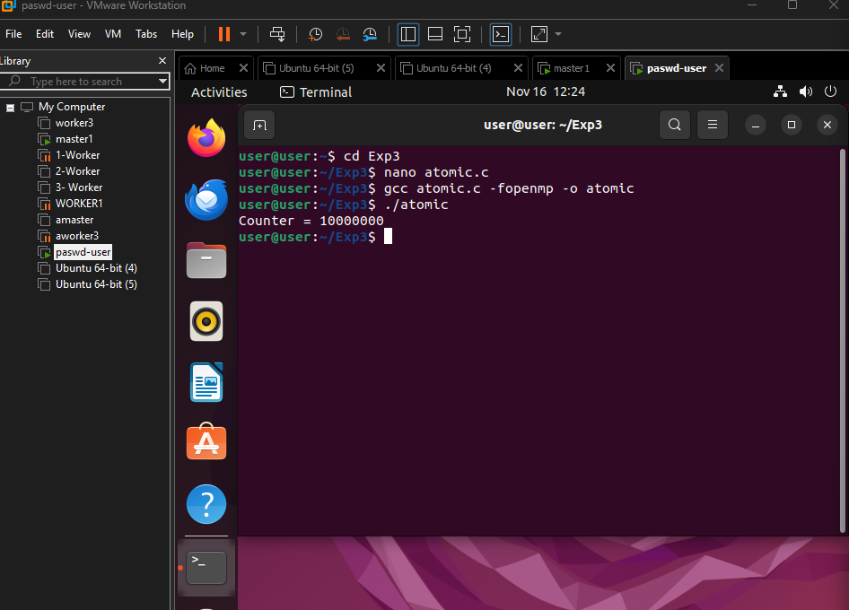
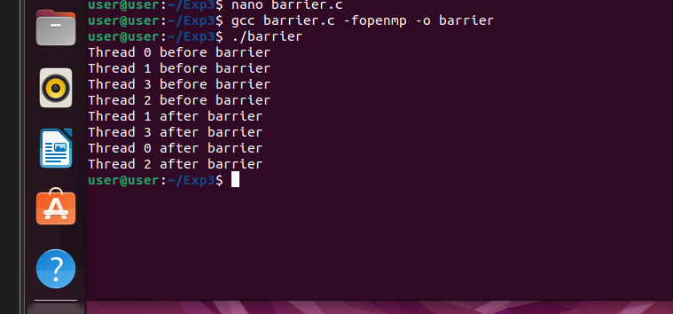
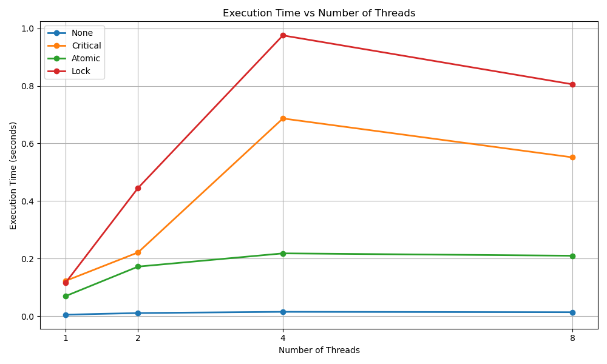
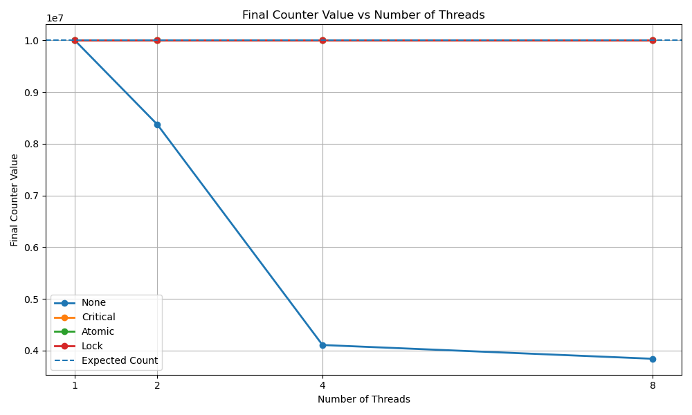
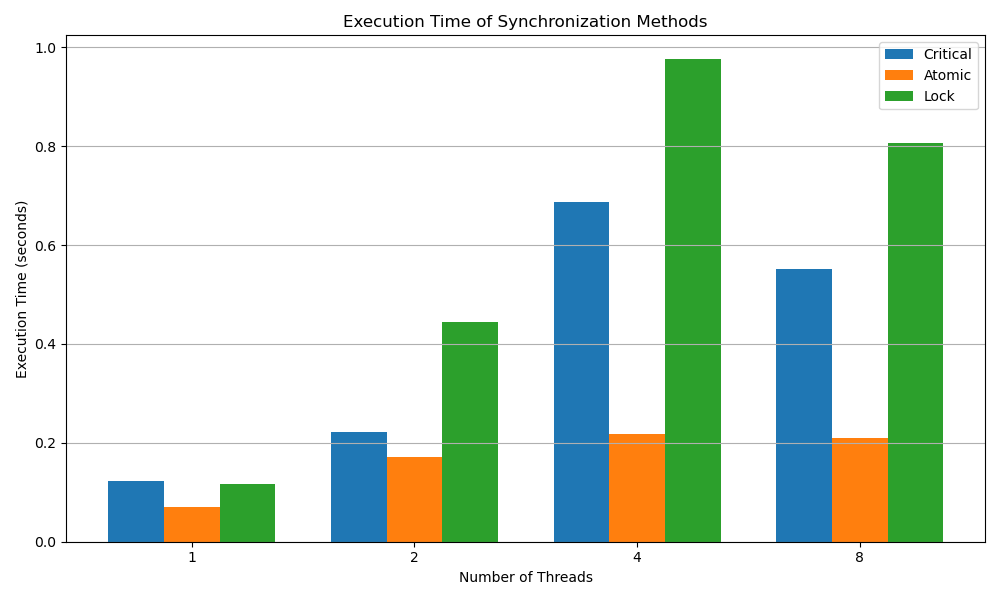

# Experiment 3: Analyze Synchronization Mechanisms in Parallel Programs

## 1. Aim

To implement and analyze different synchronization mechanisms in parallel programming and compare their correctness, execution time, and performance using multiple threads.

## 2. Technologies Used

- C Programming
- OpenMP
- POSIX Threads (Pthreads)
- POSIX Semaphores
- GCC Compiler
- Ubuntu Linux
- Python and Matplotlib

## 3. Experiments Performed

1. Race Condition
2. Critical Section
3. Atomic Operation
4. Barrier Synchronization
5. Semaphore Synchronization
6. Lock Synchronization
7. Performance Comparison

---

## 4. Experiment 1: Race Condition

**Description:** Demonstrates what happens when multiple threads update a shared variable without synchronization. This can cause lost updates and incorrect results.

**Source File:** `race.c`

**Compile and Run:**

```bash
gcc race.c -fopenmp -o race
./race
```

### Screenshots

**Creating, compiling and executing the program:**



---

## 5. Experiment 2: Critical Section

**Description:** Uses the OpenMP `critical` directive to ensure that only one thread at a time executes the protected section.

**Source File:** `critical.c`

**Compile and Run:**

```bash
gcc critical.c -fopenmp -o critical
./critical
```

**Expected Result:**

```text
Counter = 10000000
```

### Screenshots



---

## 6. Experiment 3: Atomic Operation

**Description:** Uses the OpenMP `atomic` directive to protect a shared-variable increment operation.

**Source File:** `atomic.c`

**Compile and Run:**

```bash
gcc atomic.c -fopenmp -o atomic
./atomic
```

**Expected Result:**

```text
Counter = 10000000
```

### Screenshots



---

## 7. Experiment 4: Barrier Synchronization

**Description:** Demonstrates barrier synchronization. All threads must reach the barrier before any thread can proceed beyond it.

**Source File:** `barrier.c`

**Compile and Run:**

```bash
gcc barrier.c -fopenmp -o barrier
./barrier
```

### Observation

All threads complete their before-barrier operations before proceeding to their after-barrier operations.

### Screenshots



---

## 8. Experiment 5: Semaphore Synchronization

**Description:** Uses POSIX semaphores to control access to a shared counter and prevent conflicting updates.

**Source File:** `semaphore.c`

**Compile and Run:**

```bash
gcc semaphore.c -pthread -o semaphore
./semaphore
```

**Expected Result:**

```text
Counter = 200000
```

Two threads perform 100,000 increments each.

### Screenshots


---

## 9. Experiment 6: Lock Synchronization

**Description:** Uses OpenMP locks to provide explicit mutual exclusion. A thread must acquire the lock before accessing the protected shared counter and release it afterward.

**Source File:** `compare_sync.c`

The lock implementation is included in the synchronization comparison program.

**Compile and Run:**

```bash
gcc compare_sync.c -fopenmp -o compare_sync
./compare_sync
```

### Observation

The lock mechanism produced the correct final counter value for all tested thread counts.

---

## 10. Performance Comparison

The comparison was performed using 1, 2, 4 and 8 threads.

### Execution Time Results

<table>
  <thead>
    <tr>
      <th>Mechanism</th>
      <th>1 Thread</th>
      <th>2 Threads</th>
      <th>4 Threads</th>
      <th>8 Threads</th>
    </tr>
  </thead>
  <tbody>
    <tr>
      <td>None</td>
      <td>0.0049</td>
      <td>0.0106</td>
      <td>0.0148</td>
      <td>0.0134</td>
    </tr>
    <tr>
      <td>Critical</td>
      <td>0.1224</td>
      <td>0.2213</td>
      <td>0.6869</td>
      <td>0.5517</td>
    </tr>
    <tr>
      <td>Atomic</td>
      <td>0.0696</td>
      <td>0.1720</td>
      <td>0.2180</td>
      <td>0.2098</td>
    </tr>
    <tr>
      <td>Lock</td>
      <td>0.1164</td>
      <td>0.4454</td>
      <td>0.9756</td>
      <td>0.8056</td>
    </tr>
  </tbody>
</table>

*Execution time is measured in seconds.*

### Graph 1: Execution Time Comparison



### Graph 2: Final Counter Value Comparison



### Graph 3: Synchronization Methods Comparison



### Performance Observations

- None was incorrect with multiple threads because of race conditions.
- Critical, Atomic and Lock produced the correct final counter value.
- Atomic was the fastest among the protected methods in these measurements.
- Lock had the highest execution time among the protected methods.
- Increasing the number of threads did not necessarily improve performance because of synchronization overhead and contention.

---

## 11. Graph Generation

Graphs were generated using Python and Matplotlib.

**Python File:** `plot_graphs.py`

Install Matplotlib:

```bash
sudo apt install python3-matplotlib
```

Generate the graphs:

```bash
python3 plot_graphs.py
```

---

## 12. Project Structure

```text
Exp3/
│
├── screenshots/
│   ├── race.png
│   ├── critical.png
│   ├── atomic.png
│   ├── barrier.png
│   ├── semaphore.png
│   ├── execution_time.png
│   ├── counter_comparison.png
│   └── synchronization_comparison.png
│
├── race.c
├── critical.c
├── atomic.c
├── barrier.c
├── semaphore.c
├── compare_sync.c
├── plot_graphs.py
├── README.md
└── .gitignore
```

---

## 13. Conclusion

This experiment demonstrated the importance of synchronization in parallel programming.

Race conditions can produce incorrect results when multiple threads access shared data without protection. Critical sections, atomic operations, locks and semaphores provide mechanisms to protect shared resources, while barriers coordinate thread execution.

The performance comparison demonstrated that synchronization introduces overhead and increasing the number of threads does not always improve execution time.

Overall, this experiment provided practical understanding of synchronization mechanisms, mutual exclusion, thread coordination, correctness and performance in parallel programs.
