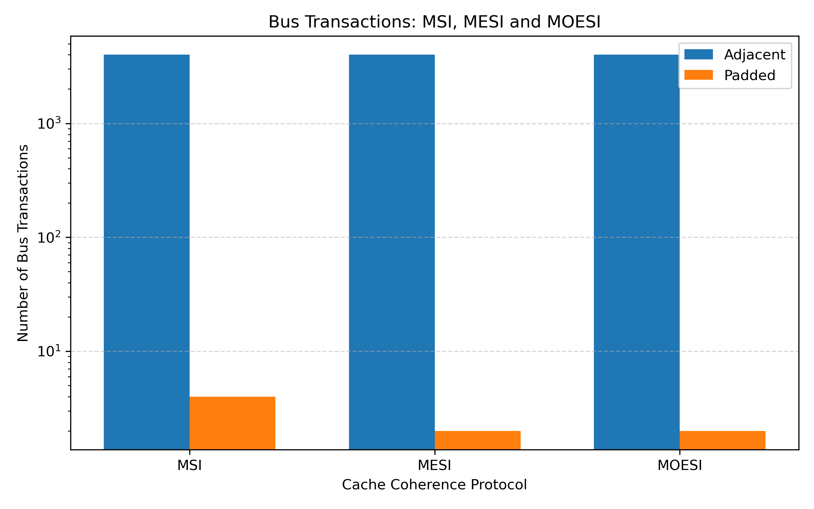
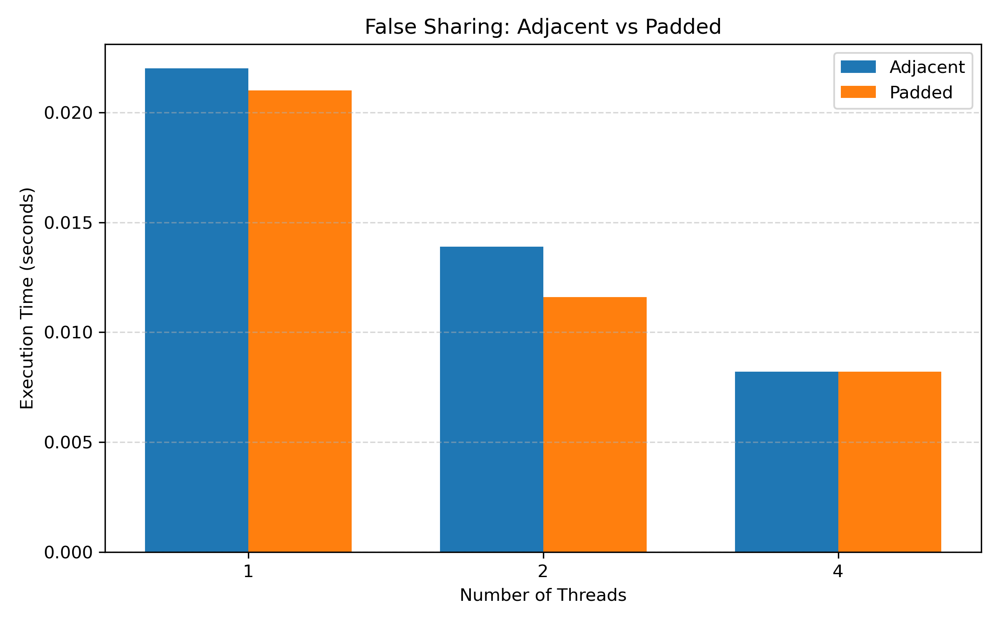
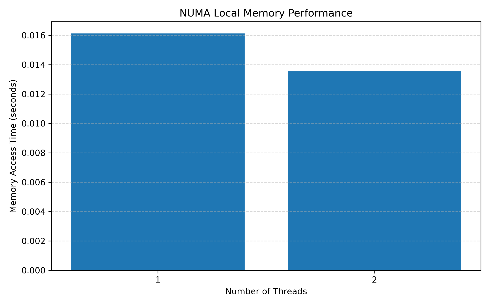

# Experiment 4: Cache Coherence and NUMA Memory Performance

## 1. Overview

This experiment explores cache coherence protocols, false sharing, and NUMA (Non-Uniform Memory Access) memory performance using C, Python, and OpenMP.

## 2. Objectives

- Study MSI, MESI, and MOESI cache coherence protocols.
- Understand cache states, invalidations, and bus transactions.
- Demonstrate false sharing in multi-threaded programs.
- Compare adjacent and cache-line-padded memory layouts.
- Measure local NUMA memory access performance.
- Analyze experimental results using graphs.

## 3. Technologies Used

| Technology | Purpose |
|---|---|
| C | Performance experiments |
| Python 3 | Cache coherence simulation |
| OpenMP | Multi-threaded programming |
| GCC | Compilation |
| Ubuntu Linux | Experimental environment |
| Matplotlib | Graph visualization |
| numactl | NUMA memory binding |

## 4. Project Structure

```text
Exp4/
├── src/
│   ├── coherence_sim.py
│   ├── compare_numa.c
│   ├── numa_sweep.c
│   └── plot_exp4.py
├── results/
│   ├── graph1_false_sharing.png
│   ├── graph2_numa_performance.png
│   └── graph3_coherence_protocols.png
├── screenshots/
│   ├── cache_coherence/
│   ├── false_sharing/
│   └── numa/
├── build/                 # Local executables (not tracked)
├── .gitignore
└── README.md
```

## 5. Experiment 1: Cache Coherence Protocol Simulation

### Objective

To understand how multiple processor caches maintain consistent copies of shared memory.

### Protocols Studied

| Protocol | Cache States | Important Feature |
|---|---|---|
| MSI | Modified, Shared, Invalid | Basic cache coherence |
| MESI | Modified, Exclusive, Shared, Invalid | Exclusive state enables silent E-to-M transition |
| MOESI | Modified, Owned, Exclusive, Shared, Invalid | Owned state supports sharing modified data |

### Experimental Observations

- MSI uses Shared and Modified states to maintain consistency.
- MESI introduces the Exclusive state, reducing unnecessary bus transactions.
- MOESI introduces the Owned state, allowing modified cache data to be shared without immediate writeback.

### Simulation Screenshots

**Cache Coherence Simulation — Screenshot 1**


**Cache Coherence Simulation — Screenshot 2**


### Protocol Comparison Results

Results obtained from the software simulation with 1,000 iterations.

| Memory Layout | Protocol | Bus Transactions | Invalidations | Writebacks | Cache-to-Cache Transfers |
|---|---|---:|---:|---:|---:|
| Adjacent | MSI | 4000 | 1999 | 1999 | 0 |
| Adjacent | MESI | 3999 | 1999 | 1999 | 0 |
| Adjacent | MOESI | 3999 | 1999 | 0 | 1999 |
| Padded | MSI | 4 | 0 | 0 | 0 |
| Padded | MESI | 2 | 0 | 0 | 0 |
| Padded | MOESI | 2 | 0 | 0 | 0 |

### Graph: Cache Coherence Protocol Comparison



> Note: These are software simulation results, not direct measurements of physical processor cache controllers.

## 6. Experiment 2: False Sharing

### Objective

To investigate how false sharing affects multi-threaded performance when different threads update separate variables that occupy the same cache line.

### Memory Layouts

| Layout | Description |
|---|---|
| Adjacent | Thread counters are stored close together in memory |
| Padded | Thread counters are separated to reduce cache-line sharing |

### Experimental Results

Median execution time from three runs:

| Threads | Adjacent Time (s) | Padded Time (s) |
|---:|---:|---:|
| 1 | 0.0220 | 0.0210 |
| 2 | 0.0139 | 0.0116 |
| 4 | 0.0082 | 0.0082 |

All configurations produced the correct total of 100,000,000 increments.

### Experimental Screenshots

**Thread Configuration: 1**


**Thread Configuration: 2**


**Thread Configuration: 4**


### Graph: False Sharing Performance



### Observation

Padding improved performance in the two-thread measurements. The four-thread median was equal for both layouts. Results can vary depending on the execution environment and virtual-machine scheduling.

## 7. Experiment 3: NUMA Memory Access Performance

### Objective

To measure local NUMA memory access performance using a 256 MB memory buffer.

### Experimental Environment

| Parameter | Value |
|---|---|
| Memory Size | 256 MB |
| NUMA Node | Node 0 |
| Available NUMA Nodes | 1 |
| Available Virtual CPUs | 4 |
| Tested Thread Counts | 1 and 2 |

### Local NUMA Memory Results

| Threads | Memory Size | Sum | Access Time (s) |
|---:|---:|---:|---:|
| 1 | 256 MB | 4,194,304 | 0.016123 |
| 2 | 256 MB | 4,194,304 | 0.013546 |

### NUMA Screenshots

**Local NUMA Memory Access**


**Remote NUMA Access Limitation**


### Graph: NUMA Memory Performance



### NUMA Limitation

The Ubuntu virtual machine exposed only one NUMA node (Node 0).

- Local memory access was tested successfully.
- Remote NUMA memory access could not be tested.
- No remote NUMA performance measurements are claimed.

## 8. Combined Comparison

The combined program compared false-sharing layouts and local memory access.

### False Sharing Results

| Layout | Threads | Final Count | Execution Time (s) |
|---|---:|---:|---:|
| Adjacent | 1 | 100,000,000 | 0.021132 |
| Padded | 1 | 100,000,000 | 0.022178 |
| Adjacent | 2 | 100,000,000 | 0.014197 |
| Padded | 2 | 100,000,000 | 0.010992 |
| Adjacent | 4 | 100,000,000 | 0.008534 |
| Padded | 4 | 100,000,000 | 0.006375 |

### Local Memory Results

| Threads | Sum | Execution Time (s) |
|---:|---:|---:|
| 1 | 4,194,304 | 0.016123 |
| 2 | 4,194,304 | 0.013546 |

> These combined-program measurements are separate from the three-run median measurements reported in Experiment 2.

## 9. Compilation and Execution

Run these commands from the project root in Ubuntu/Linux.

### Compile NUMA Sweep

```bash
gcc -O2 src/numa_sweep.c -fopenmp -o numa_sweep
```

### Compile Combined Comparison

```bash
gcc -O2 src/compare_numa.c -fopenmp -o compare_numa
```

### Run Combined Comparison

```bash
numactl --cpunodebind=0 --membind=0 ./compare_numa
```

### Run Cache Coherence Simulation

```bash
python3 src/coherence_sim.py 1000
```

## 10. Conclusion

This experiment demonstrated MSI, MESI, and MOESI cache coherence behavior through software simulation.

The false-sharing experiment showed how cache-line organization affects multi-threaded performance. Padding improved performance in some tested configurations.

The NUMA experiment measured local memory access performance. Remote NUMA access could not be evaluated because the virtual machine exposed only one NUMA node.

Overall, the experiments demonstrate the importance of cache coherence, memory layout, and memory placement in parallel computing.
