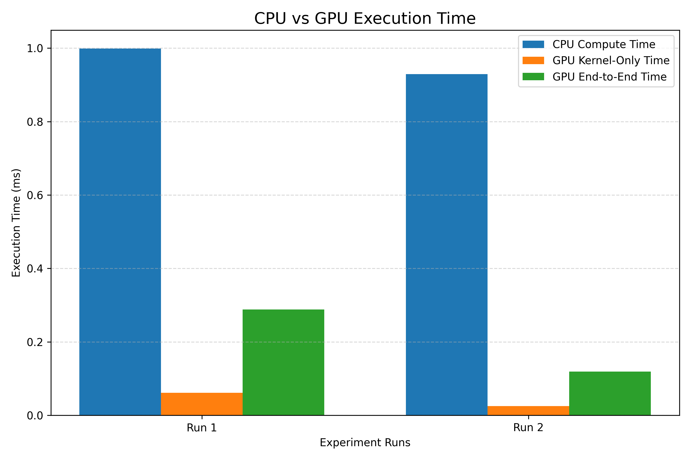
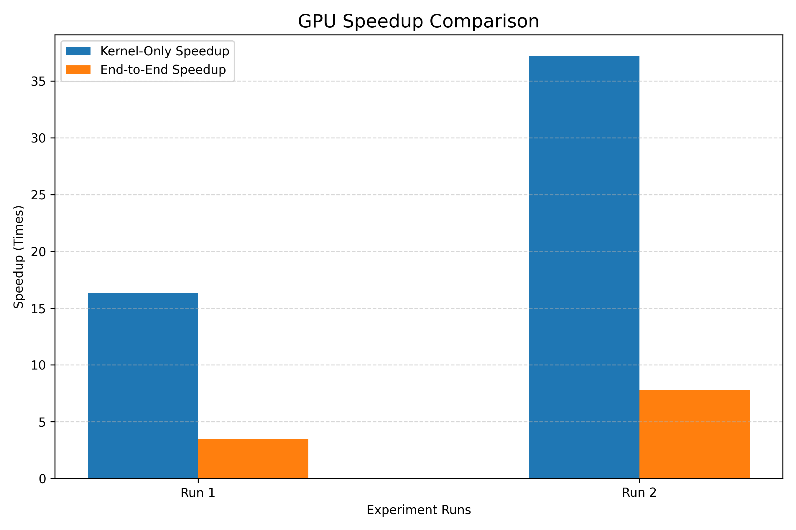
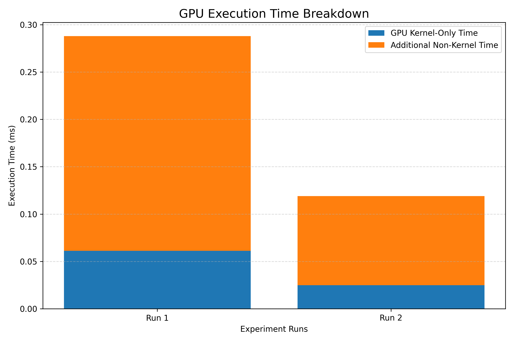
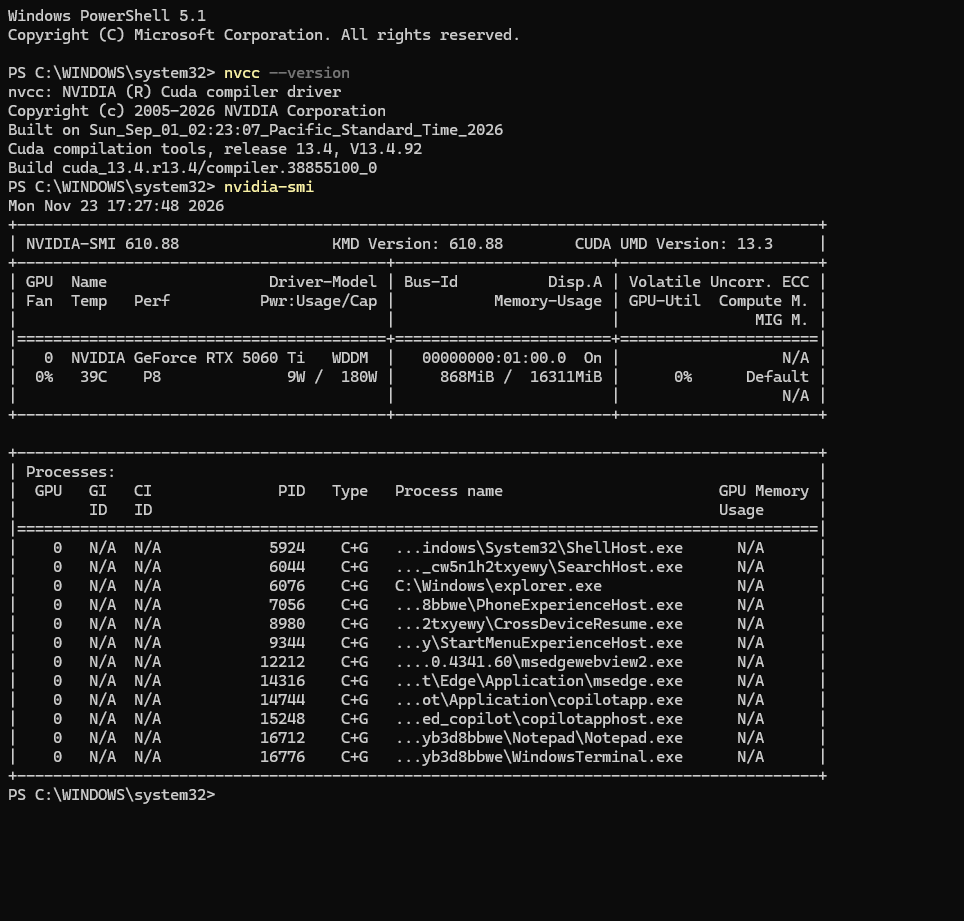
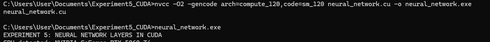
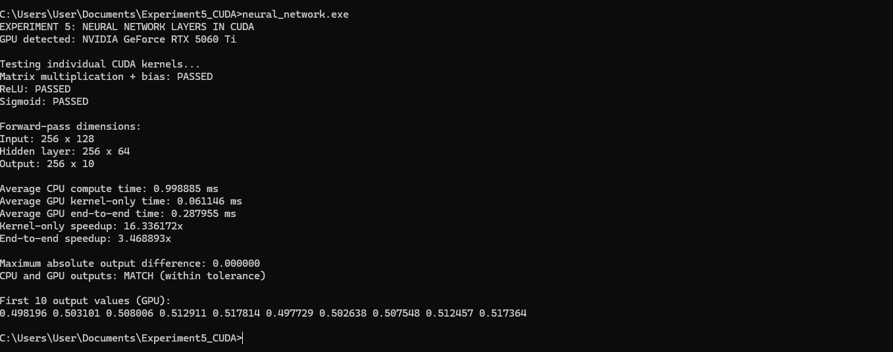
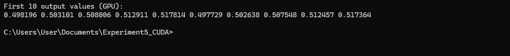

# Experiment 5: Neural Network Layers in CUDA

## Overview

This experiment demonstrates the implementation of basic neural network operations using NVIDIA CUDA. It focuses on executing neural network computations on the GPU and comparing their performance with CPU execution.

The experiment implements matrix multiplication with bias, ReLU activation, and sigmoid activation as CUDA operations. It also evaluates GPU performance using kernel-only and end-to-end execution times.

## Objectives

- Understand CUDA kernel implementation and execution.
- Implement matrix multiplication with bias.
- Implement ReLU and sigmoid activation functions.
- Perform a neural network forward pass using CUDA.
- Compare CPU and GPU execution performance.
- Calculate GPU speedup.
- Verify CPU and GPU output correctness.

## Hardware and Software Requirements

| Component | Configuration |
|---|---|
| GPU | NVIDIA GeForce RTX 5060 Ti |
| CUDA Toolkit | 13.4 |
| NVIDIA Driver | 610.88 |
| Compiler | NVIDIA CUDA Compiler (NVCC) |
| Development Environment | Visual Studio 2026 Developer Command Prompt |
| GPU Architecture | Compute Capability 12.0 (`sm_120`) |
| Programming Language | C++ with CUDA |

## Neural Network Configuration

| Parameter | Value |
|---|---:|
| Batch Size | 256 |
| Input Size | 128 |
| Hidden Layer Size | 64 |
| Output Size | 10 |
| Repetitions | 20 |

### Matrix Dimensions

| Matrix | Dimensions |
|---|---|
| Input Matrix | 256 × 128 |
| Hidden Activation | 256 × 64 |
| Output Matrix | 256 × 10 |

## Neural Network Forward Pass

The neural network forward pass consists of the following operations:

1. Input matrix multiplication with bias.
2. ReLU activation on the hidden layer.
3. Output matrix multiplication with bias.
4. Sigmoid activation on the output layer.

### Forward Pass Flow

```text
Input
  |
  v
Matrix Multiplication + Bias
  |
  v
ReLU Activation
  |
  v
Matrix Multiplication + Bias
  |
  v
Sigmoid Activation
  |
  v
Final Output
```

## CUDA Kernel Implementation

The experiment implements the following three CUDA kernels:

| CUDA Kernel | Description |
|---|---|
| Matrix Multiplication + Bias | Performs matrix multiplication and adds the bias |
| ReLU | Applies the ReLU activation function |
| Sigmoid | Applies the sigmoid activation function |

All three CUDA kernels executed successfully and passed their individual tests.

## Compilation and Execution

### 1. Check CUDA Compiler

```bash
nvcc --version
```

### 2. Compile the CUDA Program

```bash
nvcc -O2 -gencode arch=compute_120,code=sm_120 neural_network.cu -o neural_network.exe
```

### 3. Execute the Program

```bash
neural_network.exe
```

## Experimental Results

The experiment was executed in two runs, and the following performance measurements were recorded.

### 1. CPU and GPU Execution Time

| Measurement | Run 1 (ms) | Run 2 (ms) |
|---|---:|---:|
| CPU Compute Time | 0.998885 | 0.928910 |
| GPU Kernel-Only Time | 0.061146 | 0.024962 |
| GPU End-to-End Time | 0.287955 | 0.118950 |

### 2. GPU Speedup

| Measurement | Run 1 | Run 2 |
|---|---:|---:|
| Kernel-Only Speedup | 16.336172× | 37.213560× |
| End-to-End Speedup | 3.468893× | 7.809248× |

### 3. GPU Execution Time Breakdown

| Measurement | Run 1 (ms) | Run 2 (ms) |
|---|---:|---:|
| GPU Kernel-Only Time | 0.061146 | 0.024962 |
| Additional Non-Kernel Time | 0.226809 | 0.093988 |
| GPU End-to-End Time | 0.287955 | 0.118950 |

Additional non-kernel time is calculated as:

```text
Additional Time = GPU End-to-End Time - GPU Kernel-Only Time
```

It represents the additional measured time outside kernel execution and is not necessarily only data-transfer time.

## Performance Graphs

The following graphs compare the CPU and GPU performance across the two experimental runs.

### 1. CPU vs GPU Execution Time

This graph compares CPU compute time, GPU kernel-only time, and GPU end-to-end time.



### 2. GPU Speedup Comparison

This graph compares kernel-only speedup and end-to-end speedup.



### 3. GPU Execution Time Breakdown

This graph illustrates GPU kernel-only execution time and additional non-kernel time as components of end-to-end execution time.



## Output Validation

The CPU and GPU implementations were compared to verify computational correctness.

| Validation | Result |
|---|---|
| Matrix Multiplication + Bias | PASSED |
| ReLU | PASSED |
| Sigmoid | PASSED |
| Maximum Absolute Output Difference | 0.000000 |
| CPU and GPU Output Comparison | MATCH |
| Validation Tolerance | 1e-4 |

### First 10 GPU Output Values

```text
0.498196  0.503101  0.508006  0.512911  0.517814
0.497729  0.502638  0.507548  0.512457  0.517364
```

## Execution Screenshots

### 1. CUDA Environment

Shows the CUDA environment and GPU configuration.



### 2. CUDA Compilation

Shows the compilation of the CUDA program using NVCC.



### 3. Successful Execution

Shows the successful execution of the CUDA program and its performance measurements.



### 4. Final Output Values

Shows the final output values produced by the CUDA implementation.



## Conclusion

This experiment demonstrates the implementation and execution of neural network operations using NVIDIA CUDA.

The three CUDA kernels—matrix multiplication with bias, ReLU, and sigmoid—executed successfully. The CPU and GPU outputs matched with a maximum absolute difference of 0.000000.

In Run 2, the GPU achieved:

- **37.21× kernel-only speedup**
- **7.81× end-to-end speedup**

The experiment illustrates the performance benefits of GPU acceleration and highlights the importance of considering both kernel-only and end-to-end execution times when evaluating GPU performance.
