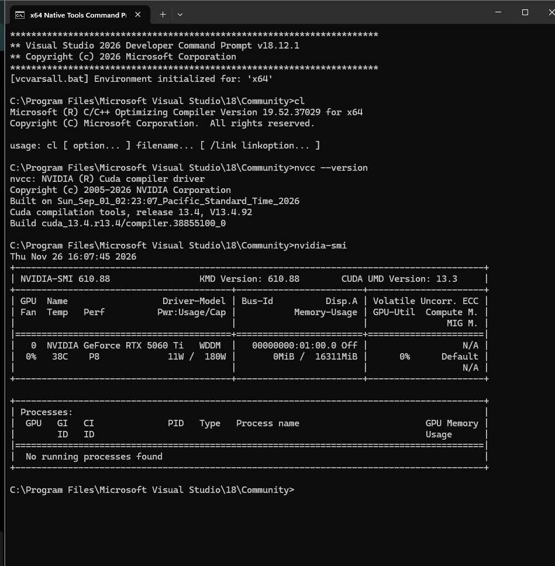
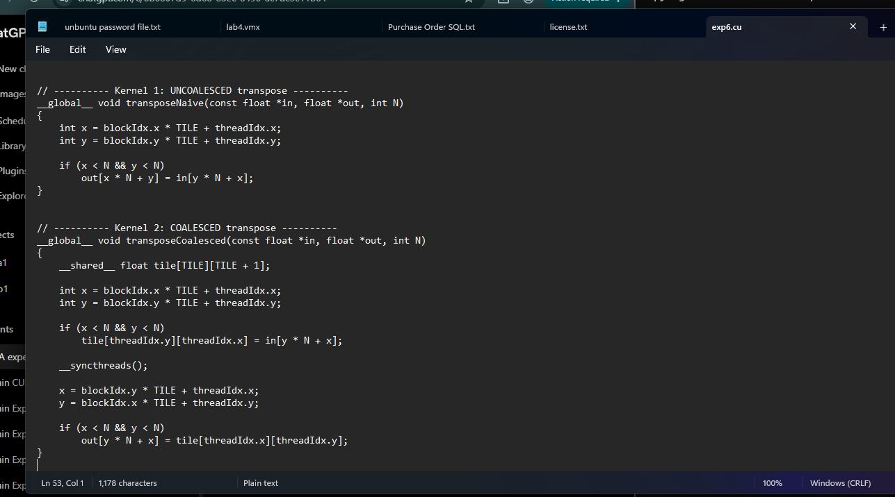
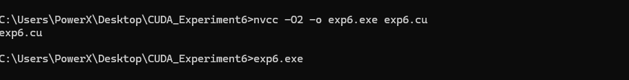
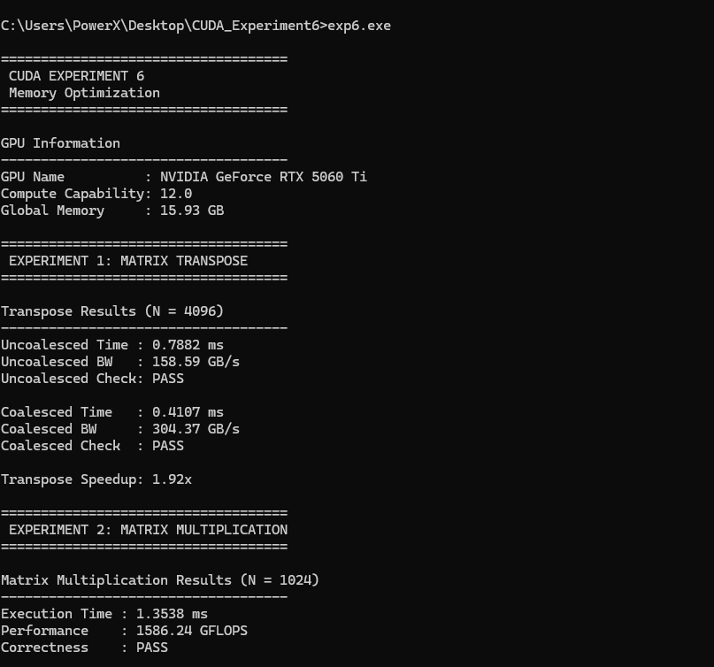
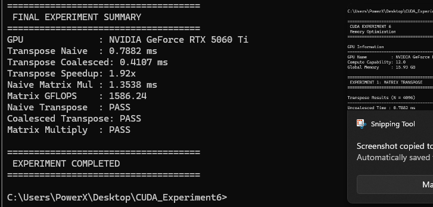
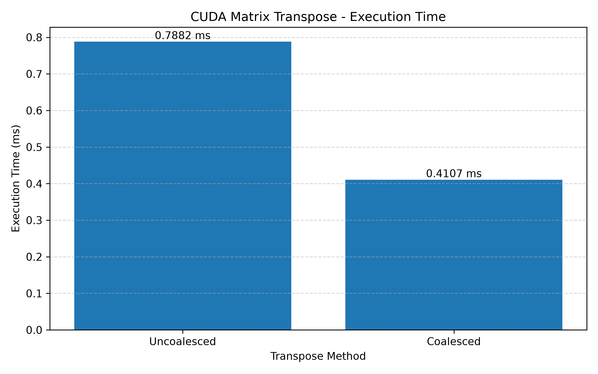
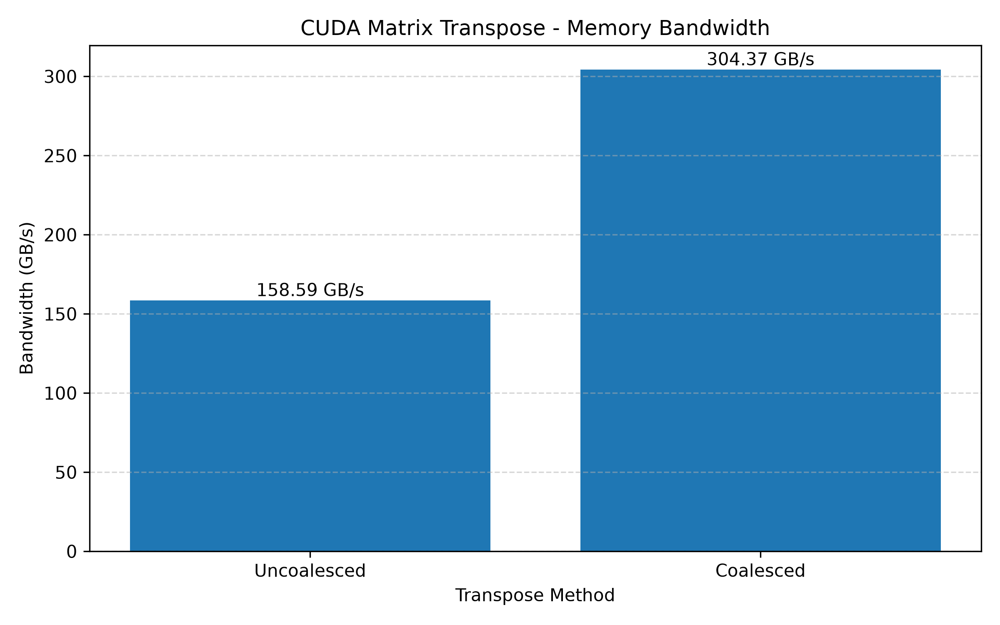

# EXPERIMENT 6: CUDA Memory Optimization

## 1. Aim

To analyze and optimize memory access patterns in CUDA programming by implementing matrix transpose using uncoalesced and coalesced memory access techniques.

The experiment also implements naive CUDA matrix multiplication and evaluates GPU performance using execution time, memory bandwidth, and GFLOPS.

---

## 2. Objectives

- Understand global memory access patterns in CUDA.
- Study uncoalesced and coalesced memory access.
- Implement matrix transpose using CUDA kernels.
- Optimize transpose using shared memory and tiling.
- Understand shared memory bank conflicts.
- Implement naive matrix multiplication using CUDA.
- Measure execution time, memory bandwidth, and computational performance.
- Verify the correctness of GPU computations.

---

## 3. Hardware and Software Requirements

### Hardware

| Component | Specification |
|---|---|
| GPU | NVIDIA GeForce RTX 5060 Ti |
| Compute Capability | 12.0 |
| Global Memory | 15.93 GB |

### Software

| Software | Purpose |
|---|---|
| Windows | Operating System |
| CUDA Toolkit 13.4 | CUDA compilation and execution |
| NVIDIA Driver | GPU support |
| Visual Studio 2026 | MSVC compiler |
| Python | Graph generation |
| Matplotlib | Data visualization |

---

## 4. Project Structure

```text
EXP-6. Memory Optimization in CUDA/
│
├── exp6.cu
├── plot_exp6.py
├── graph1_transpose_time.png
├── graph2_memory_bandwidth.png
├── README.md
│
└── screenshots/
    ├── gpu_info.png
    ├── transpose_code.png
    ├── compilation.png
    ├── transpose_results.png
    └── final_results.png
```

---

## 5. Implementation Details

### Experiment 1: Matrix Transpose

Matrix transpose converts rows into columns and columns into rows.

Two CUDA implementations were developed.

#### A. Uncoalesced Memory Access

- Threads access global memory in an inefficient pattern.
- Memory transactions are less efficient.
- This approach acts as the baseline implementation.

#### B. Coalesced Memory Access

- Threads access nearby global memory locations.
- Shared memory is used as an intermediate storage area.
- A tiled transpose technique is implemented.
- A 32 × 33 shared memory tile helps avoid shared memory bank conflicts during transposed access.

### Experiment 2: Matrix Multiplication

Naive CUDA matrix multiplication was implemented.

- Each CUDA thread calculates one output matrix element.
- Each thread performs the required multiplication and accumulation.
- The result is stored in the output matrix.
- GPU execution time and GFLOPS are measured.
- Sampled GPU results are compared with CPU reference calculations.

---

## 6. Execution Screenshots

### 6.1 GPU Information

The experiment was executed using an NVIDIA GeForce RTX 5060 Ti GPU with Compute Capability 12.0.



### 6.2 CUDA Transpose Kernels

The CUDA source code contains both uncoalesced and coalesced matrix transpose implementations.



### 6.3 Successful Compilation

The CUDA program was compiled successfully using NVCC with native GPU architecture support.

Compilation command:

```bash
nvcc -O2 -gencode arch=compute_120,code=sm_120 -o exp6.exe exp6.cu
```



### 6.4 Matrix Transpose Execution Results

Both transpose implementations completed successfully and passed correctness verification.



### 6.5 Final Experiment Results

The final output includes matrix multiplication performance, transpose speedup, and correctness verification.



---

## 7. Experimental Results

### 7.1 Matrix Transpose Results

Matrix size: 4096 × 4096

| Parameter | Uncoalesced | Coalesced |
|---|---:|---:|
| Execution Time | 0.7882 ms | 0.4107 ms |
| Memory Bandwidth | 158.59 GB/s | 304.37 GB/s |
| Correctness | PASS | PASS |

### 7.2 Transpose Speedup

Speedup is calculated using:

**Speedup = Uncoalesced Execution Time / Coalesced Execution Time**

**Speedup = 0.7882 / 0.4107**

**Speedup = 1.92x**

The coalesced implementation achieved approximately **1.92x speedup** compared to the uncoalesced implementation in this run.

---

### 7.3 Matrix Multiplication Results

Matrix size: 1024 × 1024

| Parameter | Measured Result |
|---|---:|
| Execution Time | 1.3538 ms |
| Performance | 1586.24 GFLOPS |
| Correctness | PASS |

The naive CUDA matrix multiplication implementation successfully completed execution.

The correctness check compared 20 randomly selected output elements against CPU reference calculations.

---

## 8. Performance Graphs

### Graph 1: Matrix Transpose Execution Time

This graph compares the execution time of uncoalesced and coalesced memory access.



**Observation:**

- Uncoalesced transpose required 0.7882 ms.
- Coalesced transpose required 0.4107 ms.
- Coalesced memory access reduced execution time significantly.

### Graph 2: Memory Bandwidth Comparison

This graph compares the memory bandwidth achieved by both transpose implementations.



**Observation:**

- Uncoalesced bandwidth: 158.59 GB/s.
- Coalesced bandwidth: 304.37 GB/s.
- Coalesced access achieved substantially higher memory bandwidth.

---

## 9. Overall Performance Summary

| Metric | Result |
|---|---:|
| GPU | NVIDIA GeForce RTX 5060 Ti |
| Compute Capability | 12.0 |
| Transpose Matrix Size | 4096 × 4096 |
| Matrix Multiplication Size | 1024 × 1024 |
| Uncoalesced Transpose Time | 0.7882 ms |
| Coalesced Transpose Time | 0.4107 ms |
| Transpose Speedup | 1.92× |
| Uncoalesced Bandwidth | 158.59 GB/s |
| Coalesced Bandwidth | 304.37 GB/s |
| Matrix Multiplication Time | 1.3538 ms |
| Matrix Multiplication Performance | 1586.24 GFLOPS |
| Transpose Correctness | PASS |
| Matrix Multiplication Correctness | PASS |

---

## 10. Conclusion

In this experiment, CUDA memory optimization techniques were studied through matrix transpose and matrix multiplication.

The uncoalesced and coalesced transpose implementations were compared to understand the impact of global memory access patterns on GPU performance.

The coalesced transpose implementation achieved an execution time of 0.4107 ms compared to 0.7882 ms for the uncoalesced implementation, resulting in approximately 1.92× speedup.

Memory bandwidth also increased from 158.59 GB/s to 304.37 GB/s.

The naive matrix multiplication implementation achieved 1586.24 GFLOPS with successful sampled correctness verification.

Therefore, the experiment demonstrates that efficient memory access patterns and shared memory optimization can significantly improve CUDA GPU performance.

---

## 11. How to Compile and Run

### Compile CUDA Program

```bash
nvcc -O2 -gencode arch=compute_120,code=sm_120 -o exp6.exe exp6.cu
```

### Execute

```bash
exp6.exe
```

### Install Python Dependency

```bash
python -m pip install matplotlib
```

### Generate Performance Graphs

```bash
python plot_exp6.py
```

---

## 12. Files Included

| File | Description |
|---|---|
| `exp6.cu` | CUDA source code |
| `plot_exp6.py` | Python graph generation script |
| `graph1_transpose_time.png` | Execution time comparison |
| `graph2_memory_bandwidth.png` | Memory bandwidth comparison |
| `screenshots/` | Important experiment execution screenshots |
| `README.md` | Experiment documentation |

